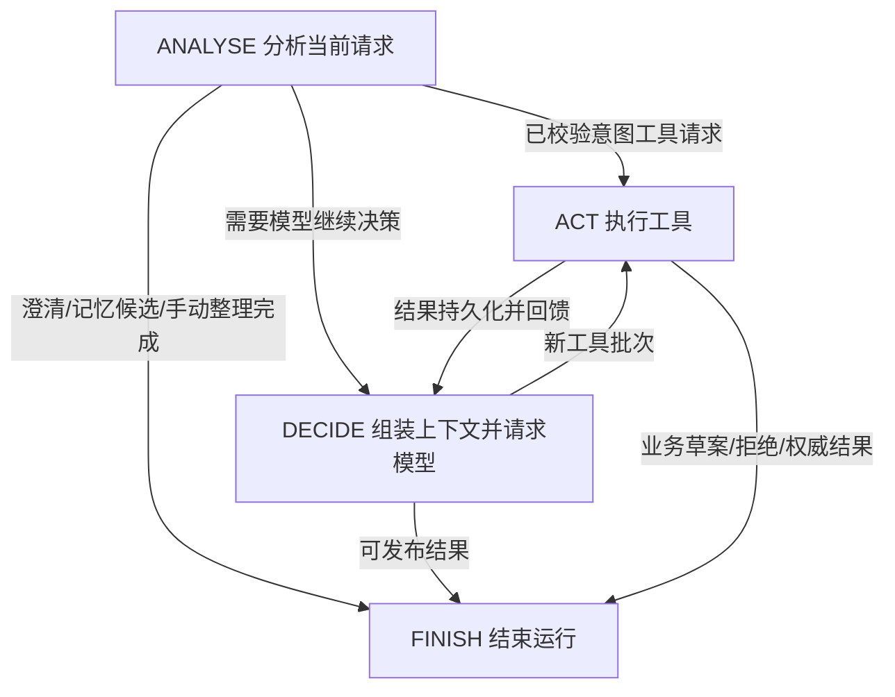

# 自研 ReAct 运行器

目的：证明模型决策、工具反馈、状态流转、上下文与执行边界的工程设计能力。当前应用不依赖 LangGraph/LangChain 编排；使用 Python asyncio、dataclass、Enum，以及现有 HTTP、Pydantic、ORM 和模型推理库。

## 核心结构

- `agent/loop.py`：不可变单轮状态、封闭状态更新协议、转换校验、调度、取消检查点、24步上限和元信息观察回调。
- `agent/runtime.py`：意图/模型决策、真实生成、工具批次执行、发布校验、会话运行和确认边界。
- `agent/tools.py`：白名单、参数/权限校验、结果引用、业务版本与重复/无进展检测。
- `agent/context.py`、`memory.py`、`store.py`：预算、摘要、保护引用、原始历史与权威记忆。
- `models/*` 和 Pi：只适配认证、消息、工具协议与usage，不接管 Agent。

每次处理创建独立 LoopState。共享 ReActLoop 实例不保存当前阶段、工具结果或用户状态。执行器消费完工具批次后清空其 response，下一次决策必须显式给出新请求。模型的原始 JSON 不能直接决定执行器阶段或修改预算。

## 控制边界

状态更新只允许 finished/response/result，finished 必须是真正bool；决策阶段的非终态必须有 assistant 工具消息，最终结果不能同时带工具请求。执行阶段不能重新提交已消费批次。无结果结束、空工具列表、未知控制字段和混合终态全部停止。

模型6次、工具8次、参数修复1次、单turn10分钟，沿用应用业务预算；24步是额外的调度保护，不是模型调用数。每次 await 前后检查截止时间，并保留协作取消点。超时、取消、审计写入失败或结果未知均向外传播，由运行服务持久化终态，不自动重放工具。

工具执行结果存入 PostgreSQL，下一次模型调用从权威历史重新组装完整组，经过上下文预算；大结果使用可重新读取的引用。记忆、文档与工具数据不提升为权限。业务提交仍由用户确认，等待确认时结束run并持久化草案，不把运行器挂起在内存中。

## 可观察与可讲解

运行中心根据真实 loop_started/loop_transition 事件显示引擎标识、分析/决策/工具/结束转换、步数、模型和工具计数。事件只带元信息；参数和结果沿用所属用户的私有记录，普通日志不加入原始对话。记录公开步骤，不解析或展示模型私有思维链。

可用四个问题解释设计：为什么有三类预算；为什么工具批次只能消费一次；为什么确认边界在业务服务；为什么上下文/记忆必须有独立权威存储。

## 验证入口与事实边界

普通：`scripts/manage.py verify`。新循环单元测试覆盖状态冲突、无进展上限、取消、过期后禁止执行、结果未知只执行一次、审计故障、并发隔离和框架导入屏蔽。真实PG集成继续验证权限、幂等、摘要/工具组和业务保护。

显式真实模型：`scripts/validation/react_loop.py --approved --channel all`；`--case`只重测指定失败项。固定输入覆盖查询、带引用RAG、等待确认草案，以及list_tickets→read_result的反馈循环。只清理本轮owned临时schema，模型草案不确认。DeepSeek/Jev沿用累计15元预算和预留门禁；ChatGPT订阅单列。

旧LangGraph的三通道30轮及完整业务剧本属于历史验收；本次验收范围与失败记录见validation/react-runtime.md，不能把历史调用冒充新运行器调用。既有环境可能保留已安装的框架包；源码与依赖声明不再使用，本次不卸载环境包。
